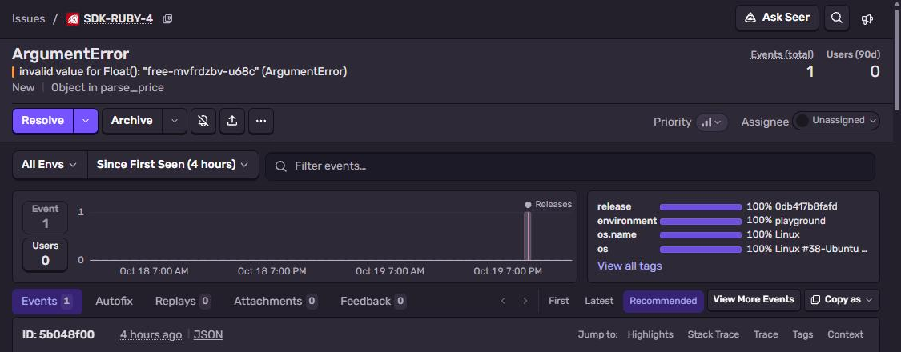
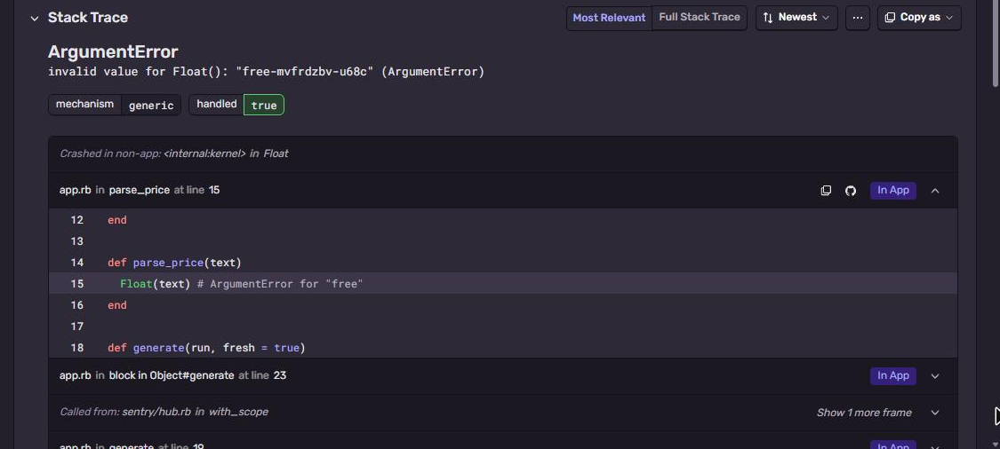

# Sentry + Ruby

Small Ruby app with the `sentry-ruby` gem, no Rails.
Part of [Sentry Playground](https://github.com/fsmaster/sentry-playground).



## What you need

- Ruby 3.2+ and Bundler
- Sentry project with platform **Ruby**

On Windows the easiest is Docker (see below), native gems need a compiler.

## 1. Get the DSN

Sentry → **Settings → Projects → (project) → Client Keys (DSN)**.

## 2. Run it

```bash
git clone https://github.com/fsmaster/sentry-sample-ruby.git
cd sentry-sample-ruby
bundle install
export SENTRY_DSN="https://<key>@<org>.ingest.us.sentry.io/<project-id>"
ruby app.rb
```

Docker:

```bash
docker build -t sentry-sample-ruby .
docker run --rm -p 8080:8080 -e SENTRY_DSN="..." sentry-sample-ruby
curl -X POST localhost:8080/trigger -d '{"run":"test-1"}'
```

## 3. Check it in Sentry

**Issues** → `ArgumentError: invalid value for Float(): "free-..."`. Top frame is `parse_price` in
`app.rb`, with the source line:



## How it works

```ruby
require "sentry-ruby"

Sentry.init do |config|
  config.dsn = ENV["SENTRY_DSN"]
  config.environment = "local"
  config.send_default_pii = false
end
```

Unhandled exceptions are sent by `at_exit` hook. For rescued ones call `Sentry.capture_exception(e)`.
In a short script call `Sentry.get_current_client.flush` before exit, otherwise the background thread
may not have time to send.

With Rails you add `sentry-rails` gem too, it adds request data and performance spans. Init is the same.

`/trigger` also takes an optional `"dsn"` in the body. The playground sends it when a visitor checks
**Use my DSN**, then only this one event goes to their project (a separate client, the global one is untouched).

## Troubleshooting

| Symptom | Why |
|---|---|
| `bundle install` fails on `bigdecimal` | Native extension needs compiler. Install `build-essential` (Debian/Ubuntu) or use Docker. |
| Event id printed, nothing in Sentry | Script exited before sending. Keep the `flush` call. |
